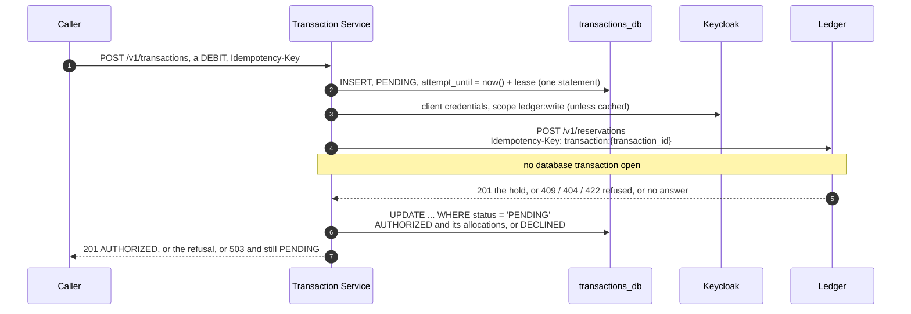

# wallet-transaction-service

> **Transactions: the orchestrator in front of the ledger.** A transaction is somebody's request to
> move money — a debit for a purchase or a stake, a credit for a payout — and this service owns its
> lifecycle: who asked, what was asked, what the ledger answered, and what state it is in now. The
> ledger owns the money itself; this service is how money is asked to move (ADR-005, ADR-012).

**State:** #1 adds the first two endpoints. `POST /v1/transactions` records a DEBIT as a hold the
ledger places, or a CREDIT as a record, and `GET /v1/transactions/{id}` reads one back. Capture and
void are still to come, so a hold ends when it expires ([Still open](#still-open)). Not deployed yet
([Reaching it](#reaching-it)).

```
./mvnw spring-boot:run     # PostgreSQL via Compose, Flyway migrates, serves on :8080, `local` profile
./mvnw test                # unit and architecture tests, no Docker
./mvnw verify              # adds the integration tests, on a real PostgreSQL (Testcontainers)
```

Then open <http://localhost:8080/swagger-ui.html>, or the collection in [`bruno/`](bruno) — see
[Calling it by hand](#calling-it-by-hand). A CREDIT needs nothing else running; a DEBIT needs the
ledger and Keycloak as well ([Running a debit locally](#running-a-debit-locally)).

Resolving `dev.vaullet:common-*` needs a `github` server in `~/.m2/settings.xml` with a
`read:packages` token: GitHub Packages requires authentication even for a public artifact.

---

## Where it sits

| | Owns | Reached by |
| --- | --- | --- |
| wallet-auth-service | who a user is, and the `account_id` money is keyed to | `/api/auth` |
| **wallet-transaction-service** | **every request to move money, and its state** | `/api/transactions`, once deployed |
| wallet-ledger-service | balances, holds and the journal — the money itself | in-cluster only, service tokens |

ADR-005 names Transaction Service "the orchestrator": it validates and records a request, asks the
ledger to hold or move the money (ADR-004's reservations), and keeps the outcome. The ledger never
sees a user's token; this service calls it with its own (ADR-008).

Its database is `transactions_db`, separate from the ledger's `vaullet_db`
(`docs/database-grouping-strategy.md` in architecture): transaction state changes often, the
journal never.

---

## The API

The first phase of ADR-012 §2's two-phase model, versioned in the path per ADR-011.

```
POST /v1/transactions         Idempotency-Key required
                              → 201 {transaction_id, account_id, type, status, amount, currency,
                                     reference?, metadata, reservation_id?, expires_at?,
                                     allocations[], decline_code?, created_at, updated_at}
                              | 400 VALIDATION_FAILED | 403 ACCESS_DENIED | 404 RESOURCE_NOT_FOUND
                              | 409 INSUFFICIENT_FUNDS | IDEMPOTENCY_KEY_REUSED | REQUEST_IN_PROGRESS
                              | 422 CURRENCY_MISMATCH | HOLD_TTL_TOO_LONG | 503 UPSTREAM_UNAVAILABLE
GET  /v1/transactions/{id}    → 200 (same representation) | 403 ACCESS_DENIED | 404 RESOURCE_NOT_FOUND
```

**A DEBIT is a hold.** The ledger is asked to hold the amount, and the answer is `201` with status
`AUTHORIZED`, the ledger's `reservation_id`, when the hold ends (`expires_at`), and which buckets
fund it ([How a debit is held](#how-a-debit-is-held)). Nothing captures a hold yet, so it ends when
it expires and the money stays the account's.

**A CREDIT is a record.** It is `AUTHORIZED` as it is recorded, and nobody is asked: money into an
account is posted to the ledger at capture, and there is no capture yet. Today a CREDIT moves
nothing.

Two kinds of caller share both endpoints: an operator's backend, which names the account, and an end
user, whose token names theirs ([Who may call it](#who-may-call-it)). The examples are an
operator's.

A DEBIT:

```http
POST /v1/transactions
Authorization: Bearer <an operator backend's token, with transaction:write>
Idempotency-Key: bet-8891
Content-Type: application/json

{
  "account_id": "3f1a8c7e-2b4d-4e6f-9a01-5c7d8e9f0a1b",
  "type": "DEBIT",
  "amount": "20.00",
  "currency": "EUR",
  "expires_in_seconds": 259200,
  "reference": "bet-8891",
  "metadata": {"market": "match-winner"}
}
```

```http
HTTP/1.1 201 Created
Location: http://localhost:8080/v1/transactions/0b6f5e1c-8d2a-4c3e-9f47-1a2b3c4d5e6f
Content-Type: application/json

{
  "transaction_id": "0b6f5e1c-8d2a-4c3e-9f47-1a2b3c4d5e6f",
  "account_id": "3f1a8c7e-2b4d-4e6f-9a01-5c7d8e9f0a1b",
  "type": "DEBIT",
  "status": "AUTHORIZED",
  "amount": "20.00",
  "currency": "EUR",
  "reference": "bet-8891",
  "metadata": {"market": "match-winner"},
  "reservation_id": "5e1f0c2a-9b8d-4e7f-a6c5-b4d3e2f1a0b9",
  "expires_at": "2026-10-26T14:02:11.497730Z",
  "allocations": [
    {"bucket_id": "b0b0b0b0-0000-4000-8000-000000000001", "bucket_type": "BONUS", "amount": "12.00"},
    {"bucket_id": "c0c0c0c0-0000-4000-8000-000000000002", "bucket_type": "CASH", "amount": "8.00"}
  ],
  "created_at": "2026-10-23T14:02:11.351204Z",
  "updated_at": "2026-10-23T14:02:11.502117Z"
}
```

A CREDIT:

```http
POST /v1/transactions
Authorization: Bearer <an operator backend's token, with transaction:write>
Idempotency-Key: win-8891
Content-Type: application/json

{
  "account_id": "3f1a8c7e-2b4d-4e6f-9a01-5c7d8e9f0a1b",
  "type": "CREDIT",
  "amount": "50",
  "currency": "EUR",
  "reference": "win-8891"
}
```

```http
HTTP/1.1 201 Created
Location: http://localhost:8080/v1/transactions/9d4c2b1a-6e5f-4a3b-8c7d-0e1f2a3b4c5d
Content-Type: application/json

{
  "transaction_id": "9d4c2b1a-6e5f-4a3b-8c7d-0e1f2a3b4c5d",
  "account_id": "3f1a8c7e-2b4d-4e6f-9a01-5c7d8e9f0a1b",
  "type": "CREDIT",
  "status": "AUTHORIZED",
  "amount": "50.00",
  "currency": "EUR",
  "reference": "win-8891",
  "metadata": {},
  "allocations": [],
  "created_at": "2026-10-23T14:05:40.118062Z",
  "updated_at": "2026-10-23T14:05:40.118062Z"
}
```

`Location` is the transaction's URL, on a replay too. `GET /v1/transactions/{id}` answers with the
same representation: one shape for the `POST`, its replays and the `GET`, because a caller polling
the `GET` wants exactly what the `POST` returned.

### The request

| Field | |
| --- | --- |
| `account_id` | The account the money moves on: wallet-auth-service's `account_id`, a UUID. An operator's backend must name it (`400 VALIDATION_FAILED` without). An end user leaves it out, since their token names their account, or names their own; any other is `403`. |
| `type` | `DEBIT`, money out of the account, held now; or `CREDIT`, money in, recorded now. Anything else, ADR-012's `WAGER` included, is `400`. |
| `amount` | A decimal string, greater than zero, at most 16 digits before the point and no finer than the currency's minor unit: `20.001` is not an amount of EUR. |
| `currency` | ISO 4217, upper case, and it must be the deployment's (`TRANSACTION_CURRENCY`): any other is `422 CURRENCY_MISMATCH`, and nothing is recorded. ADR-004 makes the currency a deployment constant; saying it is how a caller that believes it is moving another one is refused rather than misunderstood. |
| `expires_in_seconds` | DEBIT only, optional: how long the hold may stay uncaptured. Left out, the ledger's default, 300 seconds. The ceiling is the ledger's `max_hold_seconds`, 30 days by default, past which the ledger declines with `422 HOLD_TTL_TOO_LONG`. On a CREDIT it is `400`: a credit holds nothing, so there is no hold to expire. ADR-012 gives the lifetime to the caller because only the caller knows its settlement horizon: a purchase resolves in milliseconds, a match-winner market in three days. |
| `reference` | Optional, 1 to 255 characters: the caller's own, such as a bet id. Stored and returned, never interpreted, not unique. |
| `metadata` | Optional: at most 20 pairs of strings, keys non-blank and up to 40 characters, values up to 500. Stored and returned as given. |
| `capture` | Optional, and only `false`: ADR-012's authorize-and-settle in one call, which #1 does not do. `true` is `400`; `false`, or leaving it out, is the authorization this endpoint records. |

Any other field is ignored, as on every service of the platform, so ADR-012's `capture` is named
here in order to be refused: `"capture": true` is `400 VALIDATION_FAILED`, rather than a hold the
caller would mistake for a purchase ([Still open](#still-open)).

### The answer

| Field | |
| --- | --- |
| `transaction_id` | This service's id for the transaction, and the last segment of `Location`. |
| `account_id`, `type`, `currency`, `reference`, `metadata` | As asked; `account_id` as resolved, so an end user's own from their token. `metadata` is `{}` when none was given. |
| `amount` | In the currency's minor units, whatever scale it was sent in: `"50"` comes back `"50.00"` for EUR. Never rounded, since an amount finer than the minor unit is refused. |
| `status` | `PENDING`: a DEBIT the ledger has not answered, because the call failed or is in flight; repeat the request with its key. `AUTHORIZED`: the ledger holds a DEBIT's money until `expires_at`, or a CREDIT is recorded; either waits for a capture that is not built yet. `DECLINED`: the ledger refused the DEBIT, and `decline_code` says why. `CAPTURED`, `VOIDED` and `EXPIRED` are reached only when a retry of a `PENDING` debit finds the ledger's hold already settled, released or expired: the transaction takes the hold's state. All but `PENDING` and `AUTHORIZED` are terminal. |
| `reservation_id` | The ledger's hold, once the ledger has said yes to a DEBIT. |
| `expires_at` | When the ledger releases the hold unless it is captured. An absolute instant rather than the `expires_in_seconds` asked for: only the ledger knows when it placed the hold, and so when it ends. |
| `allocations` | Which buckets fund the hold, and how much each: `bucket_id`, `bucket_type` (`BONUS`, `CASH`, …) and `amount`, in the ledger's order, which is the order it spends them in. `[]` for a CREDIT and for a DEBIT without a hold. Returned rather than summed away (ADR-012 §2): an operator shows a user that 12 of a 20 stake came from bonus funds, and wagering, withdrawability and a void's refund all depend on which bucket it was. |
| `decline_code` | A `DECLINED` DEBIT only: `INSUFFICIENT_FUNDS`, `RESOURCE_NOT_FOUND` or `HOLD_TTL_TOO_LONG`, the ledger's code. The ledger's `detail` came with the refusal, and comes again with every replay of it. |
| `created_at`, `updated_at` | When it was recorded, and when it last changed. |

**`AUTHORIZED` is not revisited.** Nothing here learns that the ledger's hold expired or was
released, so after `expires_at` the money is the account's again and the transaction still says
`AUTHORIZED`. Read `expires_at` ([Still open](#still-open)).

Wire conventions, all from ADR-011 §7–8:

| | |
| --- | --- |
| Keys | `snake_case` |
| Money | decimal **string** (`"20.00"`), never a JSON number, in the currency's minor units |
| Timestamps | RFC 3339 UTC |
| Absent values | left out, not `null`: a CREDIT has no `reservation_id` key at all |
| Errors | RFC 9457 `problem+json` with a stable `code` and a `trace_id` — see [Errors](#errors) |

---

## Who may call it

Two kinds of caller share both endpoints, and **the token's `account_id` claim tells them apart**:
an end user's token names their account, an operator's backend's names none. Which kind a caller is
picks the service method; the method's rule then checks the caller again. The rules are
`TransactionAccess`'s, as `@PreAuthorize` on `TransactionService`'s methods rather than on the
controller, so they hold for whatever calls those methods next.

| | Operator's backend | End user |
| --- | --- | --- |
| Signs in | with client credentials; the token names no account | as a person; the token carries `account_id`, which wallet-auth-service writes onto the user and gitops `realm/16-vaullet-account-id.yaml` maps into the token |
| `POST` | `transaction:write`: a DEBIT or a CREDIT, on any account it names | `transaction:self` and the realm role `END_USER`: a DEBIT, on the account the token names |
| `GET` | `transaction:read`: any transaction | `transaction:self` and `END_USER`: a transaction on their own account, whoever recorded it |

**On the operator's side the scope is the permission**, as `ledger:write` is on the ledger: no
person is behind a client-credentials token whose role could narrow it. So `transaction:read` and
`transaction:write` belong only on clients that are such backends, never on one people sign in with,
where every user's token would carry them — and a member of staff, whose token names no account,
would be an operator here.

**On the end user's side the scope is not enough.** Keycloak puts a client scope in the token of
everyone who signs in through the client, staff included, so the role says who is asking and the
token's `account_id` says for which account. An end user may not credit, since money into an
account is the operator's to give, and may not name another account: either is `403 ACCESS_DENIED`.
Leaving `account_id` out is the usual way, and naming one's own is the same request:

```http
POST /v1/transactions
Authorization: Bearer <an end user's token: transaction:self, END_USER, account_id>
Idempotency-Key: 6c1f9d0e-3b7a-4e52-9f18-2d4c6b8a0e31
Content-Type: application/json

{"type": "DEBIT", "amount": "5.00", "currency": "EUR", "reference": "order-1001"}
```

**Someone else's transaction answers `404`, not `403`.** `GET` looks an end user's transaction up by
id *and* account, so one on another account answers exactly as an id that does not exist: a `403`
would confirm that the id exists.

Two tokens are refused before any rule runs, with `403 ACCESS_DENIED`: one without `sub`, because
the idempotency key belongs to the caller and a caller nobody can name cannot have one; and one
whose `account_id` is not a UUID, which read as "no account" would make its holder an operator.

An end user whose token predates their account — signed in before wallet-auth-service's
`PUT /v1/accounts/me` wrote `account_id` onto their user — carries no `account_id`, and is to this
service an operator without `transaction:write`: `403`, or `400 VALIDATION_FAILED` for a body that
names no account, since an operator's must, with a `detail` that says to create the account and sign
in again. A fresh token fixes it.

Under the `local` profile there is no token. Every request is the anonymous principal, holding
`transaction:read`, `transaction:write` and `ROLE_OPERATOR` (`vaullet.security.local` in
`application.yaml`), and recorded as `requested_by = local`: an operator. An end user's rules need an
end user's token.

---

## Idempotency

`Idempotency-Key` is **required** on `POST /v1/transactions`, 1 to 255 characters. Without the header
the answer is Spring's own `400`, with no `code` (the platform's gap, as on the ledger); blank or
longer is `400 VALIDATION_FAILED`.

**A key belongs to its caller**: it is scoped to the token's `sub`, a person's Keycloak id or an
operator client's service account, stored as `requested_by`. Two callers' identical keys are two
transactions, and neither learns anything about the other's through it.

| The same caller sends the key again | Answer |
| --- | --- |
| With the same request, already answered | The transaction **as it stands**: `201` with it, or for a `DECLINED` one the same refusal — same status, `code`, `detail` and `transaction_id`. The ledger is not asked again. |
| With the same request, still `PENDING`, nobody's attempt in flight | A new attempt at the ledger ([How a debit is held](#how-a-debit-is-held)). This is how a `503` is recovered. |
| With the same request, while another call with it is waiting for the ledger | `409 REQUEST_IN_PROGRESS`, naming the transaction. Repeat it in a moment. |
| With a different request | `409 IDEMPOTENCY_KEY_REUSED`, naming the transaction the key recorded. Nothing new is recorded. |

`201` on a replay too, as the ledger answers: a caller's retry path should not behave differently
from its first attempt, which is the point of the key. And never the first request's outcome for a
different request: answering that would tell the caller something happened which they did not ask
for, which is the dangerous failure.

**"The same request" is the request as the service understood it**, not the bytes the caller sent:
a SHA-256 (`Fingerprint`) over the type, the account as resolved, the amount without trailing zeros,
the currency, `expires_in_seconds`, `reference`, and `metadata` in key order. So `"20"`, `"20.0"`
and `"20.00"` are one amount, metadata in another order is the same metadata, and an end user naming
their own account makes the request they made without naming it. Leaving `expires_in_seconds` out
and sending `300` are two requests, though the ledger would hold both for 300 seconds: the
fingerprint is of what was asked. Each field goes in with its length in front, so no value can be
read as part of the next, and a leading `v1` names the encoding, so a stored hash is never compared
with one built another way.

**Keys never expire, because a transaction is the record of its key.** The key is a column of the
transaction, under one unique constraint with its caller, `(requested_by, idempotency_key)`, not an
entry in a cache — and the service can delete no transaction (`transaction_app` holds no `DELETE`).
ADR-012's implementation notes keep a key for 24 hours and replay the original response. Here a key
answers for as long as its transaction exists, and with the transaction as it is now: the original
response to a debit whose ledger did not answer was a `503`, and replaying that would never move it.

**A refusal is final for its key.** The same request after funds arrive still answers
`INSUFFICIENT_FUNDS`, and asks nobody. Trying again, or asking for a shorter `expires_in_seconds`
after `HOLD_TTL_TOO_LONG`, is a new request, and takes a new key.

Two requests racing with one key are settled by the unique constraint, not by a read before the
insert: the loser reads the winner's row and answers as the table says.

---

## How a debit is held



**The order is the design.** The debit is recorded `PENDING` *before* the ledger is asked, so there
is never a hold in the ledger that no transaction knows about. The ledger is asked with an
idempotency key of its own, `transaction:<transaction_id>`: one per transaction, so asking twice —
after a timeout, or by two retries at once — holds the money once, and the prefix says where a hold
in the ledger came from. And an answer is recorded only from `PENDING`, so whichever attempt writes
first decides, and every later one reads what it wrote.

**This service's own token, never the caller's.** ADR-008 has the ledger trust this service, which
has already decided who may ask; a user's token is never a way to the ledger. The token is the client
credentials of `wallet-transaction-service` (`KEYCLOAK_CLIENT_ID`), asking for `ledger:write`, which
that client must offer, as an optional scope. It is reused until 30 seconds before it expires, and a
`401` from the ledger drops it, so the next attempt fetches another. The body is `account_id`,
`amount` and, when asked for, `expires_in_seconds`; the amount goes in the currency's minor units,
`"20.00"` rather than the column's `20.0000`, which is what the ledger's own record should say too.

What the ledger answers, and what it becomes:

| The ledger | The debit | The caller gets |
| --- | --- | --- |
| `201`, the hold `HELD` | `AUTHORIZED`, with `reservation_id`, `expires_at`, and `allocations` in the ledger's order | `201` |
| `201`, the key's hold replayed already `SETTLED`, `RELEASED` or `EXPIRED` | `CAPTURED`, `VOIDED` or `EXPIRED`, with the same three | `201` |
| `409 INSUFFICIENT_FUNDS`, `404 RESOURCE_NOT_FOUND` (no such account) or `422 HOLD_TTL_TOO_LONG` | `DECLINED`, keeping the ledger's code and `detail` (at most 500 characters) | the same status and `code`, the ledger's `detail`, and `transaction_id` |
| No answer (connection refused or reset, a timeout, a name that does not resolve), `429`, or any `5xx`, `503 ACCOUNT_BUSY` included; the same from Keycloak, or `408` | stays `PENDING` | `503 UPSTREAM_UNAVAILABLE`, and `transaction_id` |
| Anything else: `401` or `403` (the token is not one it accepts), a `400`, a `404`, `409` or `422` with any other code or none, a `201` that is not the hold asked for; or Keycloak refusing the client credentials, or a `KEYCLOAK_URL` or realm that is not there | stays `PENDING` | `500 INTERNAL_ERROR`, and the reason in the log |

**Only that `201` is a yes**, and only when its body is a hold of the amount asked for, in a state
the ledger has, drawn from buckets that add up to it. A transaction marked `AUTHORIZED` is never
asked about again, so a `LEDGER_URL` that names something else must fail every attempt, loudly,
rather than authorize transactions with no money behind them. The last row is what a retry will not
mend: configuration, or the two services disagreeing about the contract. `LedgerReservationsTest`
pins how each of the ledger's answers is read.

**`503` leaves the debit `PENDING`, and a retry with the same key resumes it.** A timeout can arrive
after the ledger committed, so `PENDING` means "may or may not be held". Repeated with the same
`Idempotency-Key` and the same request, the debit is taken up again and the ledger asked again with
the same ledger key, which answers with the hold if there is one and places it if there is not. The
`503` body names the debit in `transaction_id`, so a caller that has lost its key can still read it.

### The attempt lease

No database transaction spans the call to the ledger: it would hold a connection and a row lock for
as long as the ledger takes, and a slow ledger would drain the pool. Instead a `PENDING` debit carries
a lease, `attempt_until`, and whoever holds it is the one calling the ledger.

- The `INSERT` that records the debit sets it, so the caller that recorded the row owns the first
  call from the moment the row exists: a retry arriving a millisecond later finds it in flight.
- A retry takes it over with one `UPDATE`, only where it is `NULL` or past, so two retries racing
  cannot both win; the loser answers `409 REQUEST_IN_PROGRESS`. Setting it and checking it both use
  the database's clock, never a replica's.
- An attempt that ends without an answer — the `503` and the `500` above — gives it back, so the
  caller's retry starts at once, and so does one whose answer could not be recorded, a statement
  timeout say. One whose process died keeps it until it runs out.
- Recording the answer clears it.

**It lasts as long as one attempt may: Keycloak's timeout four times, the ledger's twice, and 10
seconds.** An attempt may need a token first. While another request is fetching one it waits, but
for no longer than one fetch can take (`KeycloakTokens`), and then fetches its own: a connect and a
read each, so Keycloak's timeout four times. Without that bound, requests queued behind a Keycloak
that does not answer would each wait for every fetch before theirs, and an attempt could outlive any
lease. Then the call to the ledger, a connect and a read; the 10 seconds are for the statements on
either side. With both timeouts at their default 5 seconds, **40 seconds**: after a replica dies
mid-call, a retry finds `REQUEST_IN_PROGRESS` for at most that long. Shorter, and a lease could run
out while its attempt was still waiting, letting a second attempt start, which is what the lease
exists to prevent. Change a timeout and the lease follows.

If two attempts overlap anyway and get different answers, one held and one refused, the first to
record wins. When that is the refusal, the ledger holds money for a debit that says it was declined;
nothing here can undo that safely, so it is logged at `ERROR` with the reservation to release
(`DELETE /v1/reservations/{id}` on the ledger) or to let expire.

---

## Errors

Errors are RFC 9457 `problem+json` with a stable `code`, a `trace_id` and a `timestamp` (ADR-011
§7, written by backend-common) — all but a `401` and Spring's own `400`s, marked in the table — and
carry **`transaction_id` when the failure is about a transaction the caller recorded**: declined, a
reused key, a request still in flight, or a debit left `PENDING` by a ledger that did not answer. A
declined or pending transaction is a record the caller can read back, and a caller who reused a key
needs to know which transaction the key belongs to. A body never names a transaction its caller
could not read.

```json
{
  "type": "https://docs.vaullet.dev/errors/insufficient-funds",
  "title": "Insufficient funds",
  "status": 409,
  "detail": "available 5.0000 < requested 20.00",
  "instance": "/v1/transactions",
  "code": "INSUFFICIENT_FUNDS",
  "timestamp": "2026-10-23T14:02:11.497730Z",
  "trace_id": "68f0a1…",
  "transaction_id": "0b6f5e1c-8d2a-4c3e-9f47-1a2b3c4d5e6f"
}
```

**`code` is the contract; `detail` is for humans.** Branch on `code`, never on the prose. On a
decline the `detail` is the ledger's own.

| Status | `code` | When | Recorded | `transaction_id` |
| --- | --- | --- | --- | --- |
| 400 | `VALIDATION_FAILED` | A field missing or out of range, named in `errors` (in snake_case), `"capture": true` among them; an `Idempotency-Key` that is blank or over 255 characters. And three the service checks, named at the start of `detail`: a request without `account_id` from a token that names none, an amount finer than the currency's minor unit, `expires_in_seconds` on a CREDIT | nothing | — |
| 400 | *(none)* | No `Idempotency-Key` header; a body that does not parse, or whose `account_id` or `amount` does not; an `{id}` that is not a UUID. Spring's own `400`: the platform's gap, as wallet-ledger-service's README describes | nothing | — |
| 401 | *(no body)* | No token, or one that does not validate. Never under `local` | nothing | — |
| 403 | `ACCESS_DENIED` | The rule refuses: no `transaction:write` or `transaction:read`; for an end user, no `transaction:self` or `END_USER`, a CREDIT, or another account. Also a token without `sub`, or whose `account_id` is not a UUID | nothing | — |
| 404 | `RESOURCE_NOT_FOUND` | `POST`: the ledger knows no such account | `DECLINED` | yes |
| 404 | `RESOURCE_NOT_FOUND` | `GET`: no such transaction, or, for an end user, none on their account | — | — |
| 409 | `INSUFFICIENT_FUNDS` | The ledger refused the hold: the account's available balance is below the amount | `DECLINED` | yes |
| 409 | `IDEMPOTENCY_KEY_REUSED` | This caller's key recorded a different request | nothing new | the key's |
| 409 | `REQUEST_IN_PROGRESS` | The same request's call to the ledger is in flight; repeat it in a moment | — | yes |
| 422 | `CURRENCY_MISMATCH` | Not the deployment's currency | nothing | — |
| 422 | `HOLD_TTL_TOO_LONG` | `expires_in_seconds` past the ledger's `max_hold_seconds` | `DECLINED` | yes |
| 500 | `INTERNAL_ERROR` | The ledger or Keycloak refused this service, or answered something nobody expected: configuration, which a retry alone will not mend. Once it is fixed, the same key resumes the debit | `PENDING` | — |
| 503 | `UPSTREAM_UNAVAILABLE` | The ledger or Keycloak did not answer, or answered "not now". Repeat with the same key | `PENDING` | yes |

`INSUFFICIENT_FUNDS` and `HOLD_TTL_TOO_LONG` are the ledger's codes, passed through with the same
status and meaning: an integrator sees one catalogue, and does not have to learn that the
transaction service and the ledger are two services. `TransactionErrorType` declares them again,
identically, because the platform's two rules disagree about sharing them: the ledger's
`LedgerErrorType` says a code becomes shared when a second service raises it, which this service
does, and `backend-common`'s `CommonErrorType` holds only what a service that knows nothing about
money would raise, which these are not.

Every `400`, `401` and `403`, and `CURRENCY_MISMATCH`, comes before anything is recorded and before
the key is looked at: a reused key with another currency is `CURRENCY_MISMATCH`, not
`IDEMPOTENCY_KEY_REUSED`. A statement that cannot finish inside the two-second `statement_timeout`
gets the platform's answer to a lock, `503 RESOURCE_BUSY` with `Retry-After`.

ADR-012 §7 lists codes #1 never answers: `ACCOUNT_SUSPENDED`, because an account's status is not
checked here (the freeze is the gateway's to enforce, wallet-auth-service's build order step 3);
`TRANSACTION_NOT_CAPTURABLE`, with no capture; `LIMIT_EXCEEDED` and `RATE_LIMITED`; and
`UNAUTHENTICATED`, where a `401` has no body. Two more it names differently: see
[Still open](#still-open).

---

## Calling it by hand

[`bruno/`](bruno) is a [Bruno](https://www.usebruno.com) collection for both endpoints, as each kind
of caller, kept in this repository so a request changes in the same pull request as its endpoint. It
is in Bruno's YAML format, which needs Bruno 3.1 or later: *Open Collection* on the folder.

| Environment | Base URL | Sign-in |
| --- | --- | --- |
| `local` | `http://localhost:8080` | None. The `local` profile runs every request as the anonymous principal with the operator's scopes, and the environment's empty OAuth2 URLs keep Bruno from asking for a token. |
| `prod` | `https://vaullet.dev/api/transactions`, once deployed | The first request opens Keycloak's sign-in page through the demo client `bruno` (authorization code with PKCE). Sign in as an end user whose token carries `account_id`. |

*My transactions* is an end user's side. *Create my debit* debits the signed-in user's own account
without naming it, *Repeat my debit* sends the same request with the same key, and *Get my
transaction* reads it back. *Create my debit* makes a new `Idempotency-Key` each time it is sent
(`bru.interpolate("{{$randomUUID}}")` in its script) and keeps it as `my_debit_key`; *Repeat my
debit* sends that key again and checks that the answer names the same transaction. That is the
retry, and after a `503` it is also what resumes the debit. Nothing puts money into an account
through the API yet, so in `prod` the usual answer is `409 INSUFFICIENT_FUNDS`, recorded `DECLINED`:
replayed as the same refusal, read back as `DECLINED`. The folder needs a token with
`transaction:self`, which `bruno` hands out once gitops' change for this service is in
([Reaching it](#reaching-it)). Under `local` it is skipped: the anonymous principal is an operator
and names no account.

*Operator* is an operator's backend's side. *Create DEBIT* and *Create CREDIT* name the
environment's `account_id`, and *Get transaction* reads back the last transaction a create named.
Each create sends `{{$randomUUID}}` as its key, so every send is a new transaction. **No client of
the realm can get `transaction:write` yet**, so these work only against a local run, where the
`local` profile hands the anonymous caller the operator's scopes; under `prod` they are skipped until
an operator client exists, whose client credentials will replace the collection's sign-in for this
folder. Locally *Create CREDIT* is `201` with nothing else running, and *Create DEBIT* answers what
the ledger does: `503 UPSTREAM_UNAVAILABLE` while the ledger or Keycloak is not running,
`404 RESOURCE_NOT_FOUND` for an account the ledger does not know, `409 INSUFFICIENT_FUNDS` for one it
does, all of which the request accepts. A `500` there means Keycloak answered but refused this
service's client ([Running a debit locally](#running-a-debit-locally)).

Every request asserts its status, so `bru run --env local` in `bruno/` (the CLI, `@usebruno/cli`)
checks a local run end to end. The CLI cannot do the browser sign-in, so it is for `local` only.

---

## Reaching it

Once deployed, at **<https://vaullet.dev/api/transactions>**, as wallet-auth-service is at
`/api/auth`: the gateway strips the prefix, so the transactions are at
`https://vaullet.dev/api/transactions/v1/transactions`, and tells the service the prefix
(`X-Forwarded-Prefix`), so the URLs it writes — `Location`, Swagger UI's — carry it. Swagger UI is at
<https://vaullet.dev/api/transactions/swagger-ui.html>; locally at
<http://localhost:8080/swagger-ui.html>, with no sign-in under the `local` profile.

In Swagger UI *Authorize* offers two schemes, from backend-common: `bearer-jwt` takes a pasted
token, and with `keycloak` Swagger UI signs in itself through the public client `swagger-ui`. The
second needs that client to accept this service's redirect URI,
`https://vaullet.dev/api/transactions/swagger-ui/oauth2-redirect.html`, which gitops'
`realm/26-vaullet-swagger-ui-client.yaml` lists with the change for this service.

**What the realm provides**, with gitops' change for this service, before anyone calls it with a
real token:

- the client scopes `transaction:read`, `transaction:write` and `transaction:self`, in
  `realm/15-vaullet-client-scopes.yaml`, where `TransactionAccess` says they live;
- `transaction:self` as a default scope of the clients people sign in with, `bruno` and
  `swagger-ui`, beside the `identity:self` and `account-id` they already carry;
- this service's own client, `wallet-transaction-service` (`realm/31-wallet-transaction-service.yaml`):
  confidential, client credentials only, offering `ledger:write` as an optional scope, its secret
  what `KEYCLOAK_CLIENT_SECRET` holds.

Not yet: an operator's backend, a confidential client on client credentials holding
`transaction:read` and `transaction:write` ([Still open](#still-open)).

`/actuator/health` and `/actuator/info` need no token, so `/actuator/info` says which build is
running.

---

## Configuration and profiles

| Profile | Activated by | What it changes |
| --- | --- | --- |
| *(none)* | a deployed `java -jar` | Secure by default: no `OAUTH2_ISSUER_URI` means no `JwtDecoder`, and the context refuses to start. So does a missing `TRANSACTION_CURRENCY`, `KEYCLOAK_URL`, `KEYCLOAK_CLIENT_SECRET` or `LEDGER_URL`. |
| `local` | `./mvnw spring-boot:run` | Compose's PostgreSQL on port 55434, SQL logging, all actuators, every trace sampled. EUR; Keycloak at `localhost:58080` and the ledger at `localhost:8081`; the anonymous principal as an operator. |
| `prod` | the deployment | ECS JSON logs, Flyway off: the migration Job runs it. |
| `migrate` | the migration Job, as `prod,migrate` | No web server, Flyway on, no statement timeout; exits when done. Needs none of this service's own settings: see below. |
| `test` | `@IntegrationTest` | Testcontainers' PostgreSQL; Flyway runs, so a broken migration fails the build. EUR, and Keycloak and the ledger at `.invalid` addresses, which `TransactionApiIT` replaces with one stand-in for both (`support/Upstreams`), at one-second timeouts. |

The database credential is one set of properties (`DB_URL`, `DB_USERNAME`, `DB_PASSWORD`). Which
identity it is depends on the workload: the Deployment holds `transaction_app`, which has no DDL
rights, and the migration Job holds `transaction_migrator`. `V1__app_role.sql` creates
`transaction_app` where it is missing, so a laptop's or a test's database has the grantee too.
`V2__transactions.sql` grants it `SELECT`, `INSERT` and `UPDATE` on `transactions`, `SELECT` and
`INSERT` on `transaction_allocations`, and never `DELETE` or `TRUNCATE`: a transaction ends
`DECLINED`, `VOIDED`, `EXPIRED` or `CAPTURED`, and is never erased. Every other test connects as the
database's owner, which may do anything, so `AppRoleGrantsIT` runs each statement
`TransactionRepository` issues on a connection that is `transaction_app`'s, and asserts the
refusals — no `DELETE`, `TRUNCATE` or DDL, no `UPDATE` of an allocation, nothing on
`flyway_schema_history` — by SQLSTATE `42501`.

`statement_timeout` is two seconds on every connection (`connection-init-sql`): a statement that
cannot finish in that time is a bug or a lock, and the caller is better served by an error than by a
thread parked behind it. The `migrate` profile lifts it, since a migration may take minutes.

### This service's settings

`transaction.*`, bound to `TransactionProperties`:

| Property | Environment | Default | |
| --- | --- | --- | --- |
| `transaction.currency` | `TRANSACTION_CURRENCY` | — | The deployment's currency, ISO 4217: the ledger's `LEDGER_CURRENCY`, and the two must agree, though nothing checks them against each other ([Still open](#still-open)). A request in any other is `422 CURRENCY_MISMATCH` here, before the ledger is asked. |
| `transaction.minor-units` | `TRANSACTION_MINOR_UNITS` | ISO 4217's: 2 for EUR, 0 for JPY | Decimal places of the minor unit, 0 to 4, since amounts are `NUMERIC(20,4)`. Set it only where the ledger's `LEDGER_MINOR_UNITS` is set, and to the same. |
| `transaction.keycloak.url` | `KEYCLOAK_URL` | — | Keycloak's in-cluster Service, relative path included: `http://keycloak-keycloakx-http.keycloak.svc/auth`. The token endpoint is under it. |
| `transaction.keycloak.realm` | `KEYCLOAK_REALM` | `vaullet` | |
| `transaction.keycloak.client-id` | `KEYCLOAK_CLIENT_ID` | `wallet-transaction-service` | This service's own client: confidential, client credentials, offering `ledger:write` as an optional scope |
| `transaction.keycloak.client-secret` | `KEYCLOAK_CLIENT_SECRET` | — | From OpenBao through External Secrets, like the database password |
| `transaction.keycloak.timeout` | | `5s` | Connect, and then read, on every call to Keycloak |
| `transaction.ledger.url` | `LEDGER_URL` | — | The ledger's in-cluster Service, `http://ledger-service.wallet-ledger.svc`: the only way in, since the ledger has no public route (ADR-008) |
| `transaction.ledger.timeout` | | `5s` | Connect, and then read, on every call to the ledger |

**Four have no default, and the service refuses to start without any of them**, naming the one it is
missing: `TRANSACTION_CURRENCY` (`TransactionService`), and `KEYCLOAK_URL`, `KEYCLOAK_CLIENT_SECRET`
and `LEDGER_URL` (`LedgerReservations`). Without a currency it cannot tell a request in the wrong
one, and without Keycloak and the ledger it cannot hold a cent: failing at startup beats failing at
the first request. It also refuses a currency that is not ISO 4217, one ISO 4217 gives no minor unit
unless `TRANSACTION_MINOR_UNITS` is set, and minor units outside 0 to 4.

**The two timeouts size the attempt lease**: Keycloak's four times, the ledger's twice, plus 10
seconds, so 40 seconds by default ([The attempt lease](#the-attempt-lease)). Raise one, and a retry
waits longer behind an attempt that died with its replica.

**The migration Job needs none of the upstream settings.** It runs Flyway and exits: it calls neither
the ledger nor Keycloak, and is given neither address nor secret. So the beans that need them —
`TransactionController`, `TransactionService` and `LedgerReservations` — are `@Profile("!migrate")`
and do not exist in that process. Left in, they would fail the Job for settings it never uses,
possibly after Flyway had already migrated: a migrated schema and a failed Job, wallet-auth-service's
0.10.0 bug. With no web server there is no security chain either, so no `OAUTH2_ISSUER_URI`.

### Running a debit locally

The `local` profile sets EUR and points at the other two where they run on a laptop. A CREDIT is
recorded without them. A DEBIT needs both:

- **Keycloak at `localhost:58080`** (`KEYCLOAK_HOST_PORT`), wallet-auth-service's Compose one, with a
  client scope `ledger:write` and a confidential client `wallet-transaction-service`: service
  accounts on, secret `test-only-secret` (or `KEYCLOAK_CLIENT_SECRET`), `ledger:write` offered as an
  optional scope. That realm's import has neither, so they are added by hand in its admin console.
- **The ledger at `localhost:8081`** (`LEDGER_PORT`): `SERVER_PORT=8081 ./mvnw spring-boot:run` in
  wallet-ledger-service. Its `local` profile does not look at the token.

Without them a DEBIT is `503 UPSTREAM_UNAVAILABLE` and stays `PENDING`; with a Keycloak that answers
but does not know the client or the scope, `500`. And a ledger knows only an account with a wallet,
and holds money only where someone put it, which no API does yet: so the usual local answer is
`404 RESOURCE_NOT_FOUND` or `409 INSUFFICIENT_FUNDS`, recorded `DECLINED`.

---

## Releases

As the ledger's: `scripts/version.sh` reads the release level off the commit messages since the last
tag (`feat:` a minor, `fix:` and friends a patch, `!` or `BREAKING CHANGE:` a major,
`chore:`/`docs:`/`test:`/`ci:` none). A push to `master` with something releasable builds the
image, pushes `ghcr.io/vaullet-dev/transaction-service:<version>` and then tags; anything else
builds as a pre-release and ships nothing. `scripts/version.sh explain` shows the reasoning.

---

## Package structure

```
dev.vaullet.transaction
├── TransactionApplication.java       entry point: @SpringBootApplication, @ConfigurationPropertiesScan
├── package-info.java                 @NullMarked
│
├── api/v1/                           TransactionController — bind, validate, pick the method, shape
│   │                                 the answer; Callers — which kind of caller the token is
│   └── dto/                          CreateTransactionRequest, TransactionResponse, AllocationResponse
│
├── service/                          TransactionService — the rules, the transaction boundaries and
│                                     the round trip to the ledger; TransactionAccess — the
│                                     @PreAuthorize rules; Fingerprint — what "the same request" is;
│                                     Transaction, NewTransaction, Requester, Allocation,
│                                     TransactionStatus, TransactionType
│
├── dao/                              TransactionRepository + TransactionStatements — every statement,
│                                     from db/sql/transactions/; LedgerReservations — the ledger's
│                                     POST /v1/reservations; KeycloakTokens — this service's token
│
├── common/error/                     TransactionErrorType — this service's codes;
│   │                                 TransactionApiExceptionHandler — the platform's, plus transaction_id
│   └── exception/                    the throwables
│
└── config/                           TransactionProperties — transaction.*
```

**The layers are `api.v1`, `service` and `dao`, directly under `dev.vaullet.transaction`**, with no
feature package around them, plus `common/error` and `config`. There is one feature; the ledger and
auth wrap theirs in slices (`reservation/`, `wallet/`, `account/`, …) because they have several.
`LayeringTest` holds the platform's rules (`ArchitectureRules`, from `common-test`) against it: the
layers in order, no controller reaching a repository, `JdbcTemplate` only in `dao`, nothing about
HTTP in `service`, no field injection, and no standard streams, `java.util.logging` or legacy date
API. It arrived with the first classes in the layers, because ArchUnit fails a rule that finds
nothing to check.

**Nothing HTTP-shaped leaves `dao`.** `LedgerReservations` turns the ledger's status codes into an
outcome, held or refused, or into `UpstreamUnavailableException` for "not now" and
`IllegalStateException` for "a person has to look"; `TransactionService` decides what each means for
a transaction. The service layer knowing nothing about HTTP is not decoration: capture, void and
expiry will be driven by listeners and sweepers, which have no request to bind.

**JDBC rather than JPA, as in the ledger, and the SQL is not in the Java.** The statements are the
design — the `ON CONFLICT` that settles a key, the `UPDATE` that claims a lease, the
`WHERE status = 'PENDING'` that lets the first answer win — and an ORM would hide them.
`db/sql/transactions/*.sql` holds the nine, each with its reasoning, read eagerly by
`TransactionStatements` so a renamed file fails the context rather than a request.

**`config/` is Spring configuration here**: `TransactionProperties`, the `transaction.*` keys. In the
ledger `config/` is the `ledger_config` table; nothing here keeps settings in the database.

**The catalogue stays up, the throwables go down**, as in every Vaullet repository: `common/error`
holds what the API may say, `common/error/exception` what the code throws.

Each package carries its own `package-info.java` with `@NullMarked`: Java packages do not nest for
annotation purposes, so the root's reaches only the classes directly in it.

---

## Still open

- **Capture and void.** `POST /v1/transactions/{id}/capture` and `/void` (ADR-012 §2) are not built.
  Until they are, a DEBIT's hold ends when it expires and nothing is spent, and a CREDIT moves
  nothing.
- **A sweeper for `PENDING` debits nobody retries.** One whose caller never repeats it stays
  `PENDING`, holding whatever the ledger may have placed until that hold expires. Nothing follows an
  `AUTHORIZED` debit to its end either: after `expires_at` the ledger has released the money and the
  transaction still says `AUTHORIZED`, where ADR-012 §2 moves it to `EXPIRED` and announces it.
- **A CREDIT is not checked against the ledger until capture.** It is recorded `AUTHORIZED` for any
  `account_id`, one the ledger does not know included.
- **The ledger is never told the currency.** Its `POST /v1/reservations` takes none yet
  (wallet-ledger-service's Known gaps, 1), so `TRANSACTION_CURRENCY` and `LEDGER_CURRENCY` are kept
  equal by hand: with the two apart, a debit accepted here in one currency is held there in the
  other, and neither side refuses it.
- **No realm client holds `transaction:read` or `transaction:write` yet.** gitops' change for this
  service adds the three scopes, `transaction:self` on `bruno` and `swagger-ui`, and this service's
  own client ([Reaching it](#reaching-it)), but no operator's backend exists to hold the other two,
  so the operator's side works only under the `local` profile. ADR-008's scope table, which the
  client scopes are meant to be generated from, has no `/v1/transactions` rows yet either.
- **Architecture's G6.** The ledger checks one scope, `ledger:write`, for every change — holds placed
  and released, wallets opened, frozen and closed — where ADR-008 names `ledger:reserve` for this
  service's path. So this service's token could also freeze or close any wallet. G6 accepted that
  while wallet-auth-service's outbox relay was the only holder, and put the split before "a second
  service is given `ledger:write`": this is the second.
- **ADR-012's codes.** ADR-012 §7 lists `ACCOUNT_NOT_FOUND` and `TEMPORARILY_UNAVAILABLE`; the
  platform answers `RESOURCE_NOT_FOUND` and `UPSTREAM_UNAVAILABLE`, and this service passes the
  ledger's through. One of the two has to move, and renaming a published code is a breaking change
  under ADR-011 §4.
- **ADR-012's `capture: true` default.** ADR-012 §2 authorizes and settles in one call unless the
  caller says `capture: false`; #1 only authorizes. It refuses `"capture": true` with `400`, so a
  caller following the ADR hears that no purchase happened, and takes a request without `capture`
  as `false`, where the ADR's default is `true`.
- **ADR-012's idempotency notes** keep a key for 24 hours and replay the original response; here a
  key never expires and answers with the transaction as it stands ([Idempotency](#idempotency)).
  ADR-012 should say which.
